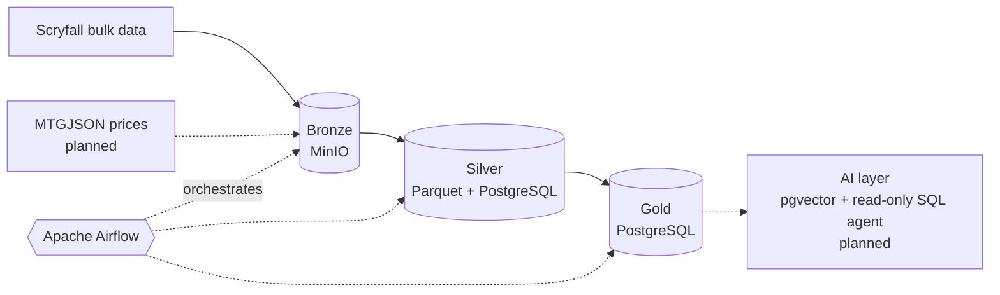

# magic_cards_etl

Data pipeline for Magic: The Gathering card data. It ingests
[Scryfall](https://scryfall.com/docs/api/bulk-data) bulk data (and
[MTGJSON](https://mtgjson.com/) price history later), orchestrated with Apache Airflow
and organized as a medallion architecture.

> **Status:** Phase 0 complete (repo hygiene). Phase 1 (Docker infrastructure) is next.
> No pipeline code yet.

> **Disclaimer:** unofficial fan project, not affiliated with or endorsed by Wizards of
> the Coast, Scryfall or MTGJSON. Magic: The Gathering and its card names and images
> belong to their owners. Please review each data source's terms of use.

## Architecture

*Planned architecture; the diagram is updated as each phase lands.*



| Layer  | Contents                                          | Storage                 |
|--------|---------------------------------------------------|-------------------------|
| Bronze | Raw files exactly as downloaded. Immutable.       | MinIO (S3-compatible)   |
| Silver | Cleaned, deduplicated, typed data.                | Parquet and PostgreSQL  |
| Gold   | Analysis-ready tables.                            | PostgreSQL              |

Silver is always reproducible from Bronze, and every task is idempotent for a given
logical date.

## Repository layout

```
dags/      Airflow DAG definitions (orchestration only)
etl/       Pure Python extract/transform/load functions (no Airflow imports)
tests/     (planned) pytest tests for etl/ and a DAG import test
scripts/   Helper scripts
docs/      Project documentation
```

## Requirements

- Python 3.12+ and [pipx](https://pipx.pypa.io/)
- From Phase 1: Docker Desktop with WSL 2 integration enabled

## Setup

```bash
# Git hooks: gitleaks (secret detection) and ruff (lint and format)
pipx install pre-commit
pre-commit install
pre-commit run --all-files

# Local configuration
cp .env.example .env   # then fill in the values; .env is git-ignored
```

## Roadmap

| Phase | Scope                                                | Status  |
|-------|------------------------------------------------------|---------|
| 0     | Repo hygiene                                         | Done    |
| 1     | Docker infrastructure (Airflow, PostgreSQL, MinIO)   | Next    |
| 2     | Bronze ingestion (Scryfall bulk)                     | Planned |
| 3     | Silver                                               | Planned |
| 4     | Gold                                                 | Planned |
| 5     | Tests, data quality and CI (GitHub Actions)          | Planned |
| 6     | MTGJSON price history                                | Planned |
| 7     | AI layer (pgvector embeddings + read-only SQL agent) | Planned |
| 8     | Optional: price model, real S3                       | Planned |
